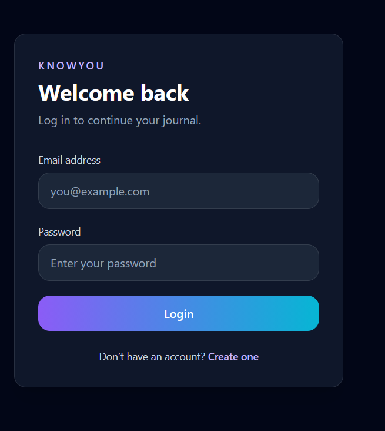
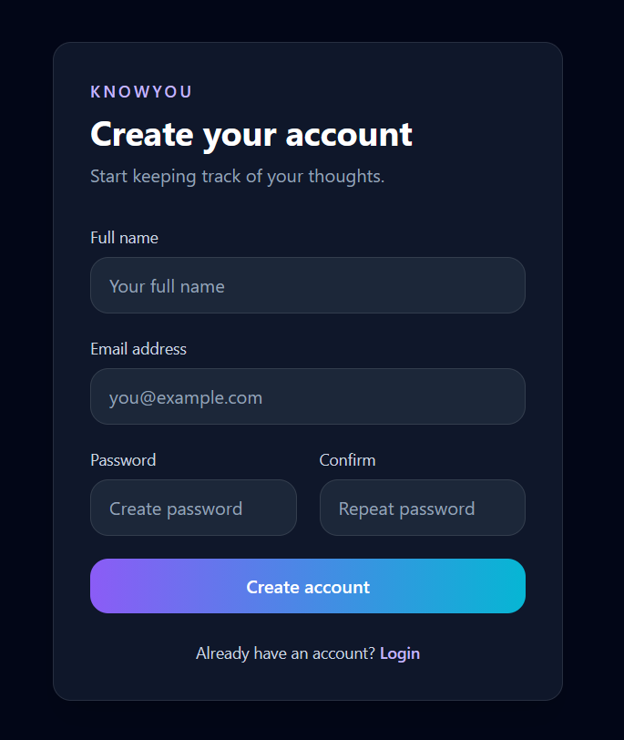
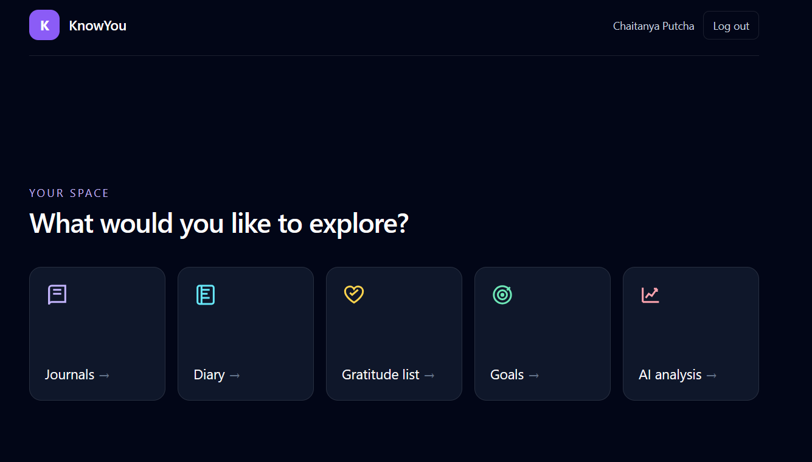

# KnowYou

KnowYou is a personal reflection app for recording thoughts, daily notes, gratitude, and goals in one simple space.

## Features

- User registration and login
- Journal writing
- Daily diary writing
- Gratitude list
- Goal tracking
- AI analysis of saved reflections

## Screenshots

### Login

### Registration

### Dashboard

## Deployment

The application is deployed using [Render](https://render.com/).

The database service is provided by [Neon](https://neon.tech/).

## Website

[Open KnowYou](https://knowyou.onrender.com)
